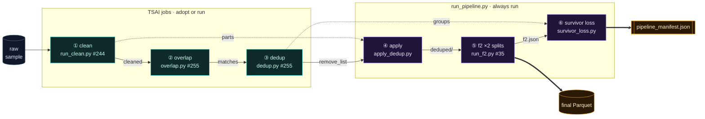
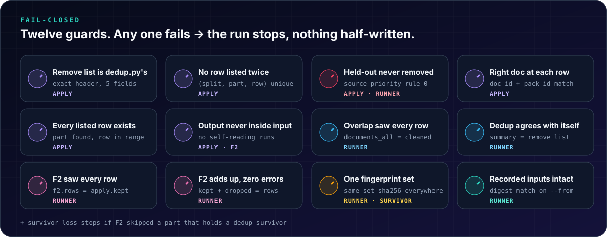
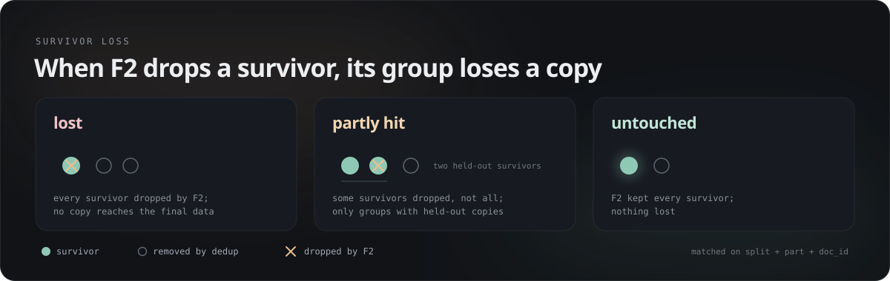
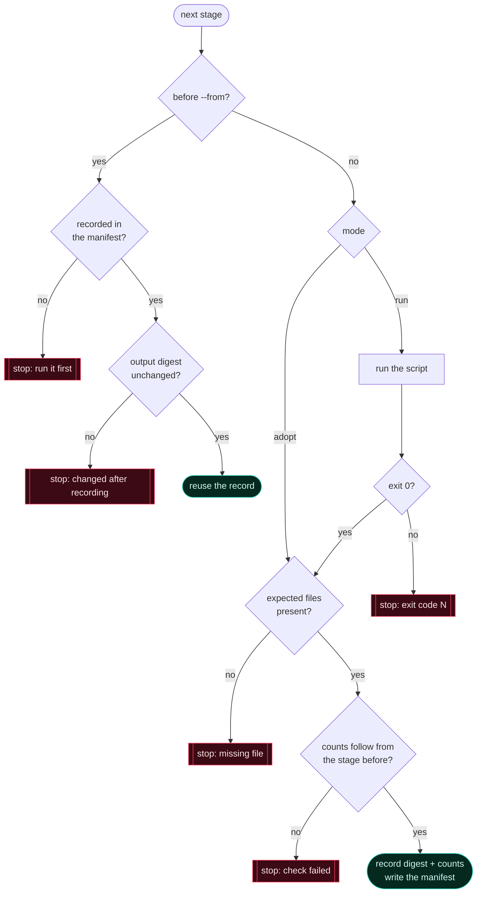

<p align="center">
  
</p>

<p align="center">
  <b>Raw sample in, decontaminated and deduplicated Parquet out.</b><br>
  One command chains the team's stages, checks that every document is accounted for, and writes a manifest TSAI can verify.
</p>

<p align="center">
  <a href="#-quick-start">Quick start</a> ·
  <a href="#-how-a-document-travels">The flow</a> ·
  <a href="#-the-count-chain">Count chain</a> ·
  <a href="#-twelve-guards">Guards</a> ·
  <a href="#-survivor-loss">Survivor loss</a> ·
  <a href="#-outputs-and-the-manifest">Outputs</a> ·
  <a href="#-tests">Tests</a> ·
  <a href="#-design-decisions">Decisions</a>
</p>

---

## ✦ At a glance

| | |
|---|---|
| **What** | The Clean → Dedup → F2 pipeline of Data A (G1): the glue that turns the outputs of #244 (cleaning), #255 (overlap and dedup) and `run_f2.py` (F2) into one reproducible run |
| **Order** | clean → overlap → dedup → **apply the remove list** → **F2** → **survivor loss** (order set by TSAI, 12 Nov) |
| **Output** | Filtered Parquet in the cleaned-parts layout (`train/`, `heldout/`, same schema, unchanged text), plus `pipeline_manifest.json` |
| **New here** | `apply_dedup.py` · `survivor_loss.py` · `run_pipeline.py` · `pipeline.json` · 35 tests |
| **Reused, never copied** | `spec_v1/run_clean.py` and `run_tokenizer_sample.py` (#244), `dedup/overlap.py` and `dedup/dedup.py` (#255), `spec_v1/run_f2.py` (PR #35) |
| **Needs** | Python 3.9+, `pyarrow`, `pytest` for the tests. Pure Python, so it runs on Windows, macOS and Linux |
| **Never** | writes document or benchmark text into a report · commits data · changes a stage's rules |

> [!NOTE]
> Cleaning, overlap and dedup are **TSAI jobs** (JOB_REQUEST rule 6). The runner **adopts** the folders TSAI returns and carries on from there. Each of those stages can also be **run** locally, for tests and small trials.

---

## ⚡ Quick start

```bash
# 1. tests: synthetic data only, about 20 s
python -m pytest teams/01-data-a/pipeline/tests -q

# 2. the whole chain, from the repository root
python -I teams/01-data-a/pipeline/run_pipeline.py --config teams/01-data-a/pipeline/pipeline.json

# 3. part of the chain: stop after apply, then resume at F2 later
python -I teams/01-data-a/pipeline/run_pipeline.py --config teams/01-data-a/pipeline/pipeline.json --to apply
python -I teams/01-data-a/pipeline/run_pipeline.py --config teams/01-data-a/pipeline/pipeline.json --from f2
```

Each step also runs on its own:

```bash
python -I teams/01-data-a/pipeline/apply_dedup.py   --cleaned <cleaned_dir> --remove-list <remove_list.csv> --out <deduped_dir>
python -I teams/01-data-a/spec_v1/run_f2.py          --inputs <deduped_dir>/train --out <final_dir>/train
python -I teams/01-data-a/pipeline/survivor_loss.py --groups <dedup_groups.csv> --f2 <final_dir> --out <report_dir>
```

Exit code `0` means every check passed. Exit code `1` means a check failed: the message says which one and where, and nothing half-written is left behind.

---

## 🧭 How a document travels

<p align="center"></p>

<details>
<summary><b>The same flow as a diagram, with every file</b></summary>



</details>

| # | Stage | Script | From | Reads | Writes |
|:-:|---|---|---|---|---|
| ① | **clean** | `spec_v1/run_tokenizer_sample.py` (`run_clean.py` inside) | #244 | raw parts | `train/**.parquet`, `heldout/**.parquet` (doc_id, text, url, lang_label, pack_id) |
| ② | **overlap** | `dedup/overlap.py --config overlap.json` | #255 | cleaned parts | `overlap_summary.json`, `overlap_matches.csv`, `overlap_docs.parquet` |
| ③ | **dedup** | `dedup/dedup.py --config dedup.json` | #255 | overlap outputs | `remove_list.csv`, `dedup_groups.csv`, `dedup_summary.json`, `dedup_log.jsonl` |
| ④ | **apply** | `pipeline/apply_dedup.py` | new | cleaned parts + `remove_list.csv` | `deduped/<split>/<part>` + `apply_dedup_summary.json` |
| ⑤ | **f2** | `spec_v1/run_f2.py`, once per split | PR #35 | `deduped/<split>` | `final/<split>/<part>`, `<part>.f2.json`, `f2_summary.json` |
| ⑥ | **survivor loss** | `pipeline/survivor_loss.py` | new | `dedup_groups.csv` + F2 reports | `report/survivor_loss.csv`, `survivor_loss_summary.json` |

---

## 🔢 The count chain

<p align="center"></p>

Every stage has to account for every document it was given. The runner checks these equalities and stops at the first one that fails:

```text
overlap.documents_all           == clean.rows                 overlap read every cleaned document
dedup.removed                   == rows(remove_list.csv)      dedup's summary agrees with its own list
dedup.heldout_removed           == 0                          rule 0: held-out copies always survive
apply.rows                      == clean.rows                 apply read the same parts
apply.removed                   == rows(remove_list.csv)      every listed row removed, exactly once
f2.rows                         == apply.kept                 F2 read every deduplicated document
f2.kept + f2.dropped + f2.errors == f2.rows,  f2.errors == 0
```

The manifest's `totals` give the headline numbers: `cleaned → removed_by_dedup → dropped_by_f2 → final`.

---

## 🛡 Twelve guards

<p align="center"></p>

<details>
<summary><b>Every check, with where it runs and the message you see</b></summary>

| Guard | Runs in | Stops with |
|---|---|---|
| Header is exactly `pack_id,split,part,row_in_part,doc_id` | apply | `header is …, expected dedup.py's …` |
| A `(split, part, row)` is listed once | apply | `… is listed twice` |
| No `heldout` row in the remove list | apply | `a held-out row … this remove list is broken` |
| `row_in_part` is a whole number ≥ 0 | apply | `row_in_part 'x' is not a whole number >= 0` |
| Every listed part exists | apply | `N listed part(s) not found under --cleaned` |
| Every listed row is inside its part | apply | `row 99 is listed, but the part has 5 rows` |
| The doc_id **and** pack_id at that row are the listed ones | apply | `doc_id is 'g1', the remove list says 'X'. The list was made from another cleaning run` |
| `--out` is not inside the input, nor the input inside `--out` | apply · F2 | `… overlap: the output would be read as input` |
| Overlap finished and read every cleaned row | runner | `check failed: overlap read every cleaned row` |
| Dedup's summary matches its remove list; no held-out removed | runner | `check failed: dedup …` |
| F2 read every row, its counts add up, zero errors, one fingerprint set | runner | `check failed: F2 …` |
| With `--from`, earlier outputs still match their recorded digest | runner | `… changed after the manifest recorded it; rerun from …` |
| Every part holding a dedup survivor has an F2 report | survivor loss | `… have no F2 report … F2 did not cover them` |

`apply_dedup.py` runs **all** of its checks before it writes the first byte. Files are written to `.tmp` and renamed, so an interrupted run never leaves a half-written Parquet behind.

</details>

> [!IMPORTANT]
> **`doc_id` alone is not a key.** In cleaned sample v0 (86 files, 1,432,552 rows), **22,773 doc_ids appear in two parts of the same pack and split**. Every step therefore finds a document by **split + part + row** (apply) or **split + part + doc_id** (survivor loss), never by doc_id alone.

---

## 🧬 Survivor loss

<p align="center"></p>

Dedup keeps one copy of each duplicate group, or every held-out copy (rule 0). F2 runs afterwards, and when it drops a survivor the removed copies are **not** brought back. TSAI accepted this on 12 Nov, on condition that the groups are **counted and listed**:

| Status | Meaning |
|---|---|
| `lost` | F2 dropped **every** survivor: no copy of the group reaches the final data |
| `partly_hit` | F2 dropped **some** survivors, not all (possible only in groups with several held-out survivors) |
| `untouched` | F2 dropped none |
| `without_survivor` | dedup kept no copy (no usable licence, rule 1); F2 cannot change that |

`survivor_loss.csv` has one row per survivor F2 dropped: `status, group_id, group_size, priority_rule, pack_id, split, part, row_in_part, doc_id, f2_items, offset`. Benchmark **item IDs** and offsets only, never text.

---

## ⚙️ Configuration

`pipeline.json`. Paths are relative to the repository root, or absolute. Keys starting with `_` are comments.

```jsonc
{
  "run_id": "sample-v0",                 // outputs go to <out>/<run_id>/
  "out": "out/pipeline",                 // git-ignored, like every out/ folder
  "stages": {
    "clean":   { "mode": "adopt", "output": "out/tokenizer_sample_v0_clean" },
    "overlap": { "mode": "adopt", "output": "out/overlap" },
    "dedup":   { "mode": "adopt", "output": "out/dedup" },
    "f2":      { "script": "teams/01-data-a/spec_v1/run_f2.py" }
  }
}
```

| Key | Values | Meaning |
|---|---|---|
| `stages.<clean\|overlap\|dedup>.mode` | `adopt` (default) · `run` | **adopt**: TSAI ran it and `output` is the returned folder. **run**: the runner calls `command` |
| `stages.<…>.command` | `["script.py", "--arg", "…"]` | run with this Python (`-I`) from the repository root; `output` is where that script writes |
| `stages.<…>.output` | folder | where the stage's files are, in both modes |
| `stages.f2.script` | path | `run_f2.py` (default `teams/01-data-a/spec_v1/run_f2.py`, from PR #35) |

`apply`, `f2` and `survivor_loss` always run, and write inside the run folder.

<details>
<summary><b>How the runner treats each stage</b></summary>



</details>

---

## 📦 Outputs and the manifest

```text
out/pipeline/<run_id>/
├── pipeline_manifest.json          ← the record of the run
├── deduped/                         ← ④ apply
│   ├── train/<pack>/part-NNNNN.parquet
│   ├── heldout/<pack>/part-NNNNN.parquet     (byte copies: dedup never removes held-out)
│   └── apply_dedup_summary.json
├── final/                           ← ⑤ F2, the pipeline's output
│   ├── train/<pack>/part-NNNNN.parquet  (+ .f2.json)
│   ├── train/f2_summary.json
│   └── heldout/…
└── report/                          ← ⑥ survivor loss
    ├── survivor_loss.csv
    └── survivor_loss_summary.json
```

<details>
<summary><b>What <code>pipeline_manifest.json</code> holds</b></summary>

```jsonc
{
  "tool": "run_pipeline.py", "run_id": "sample-v0",
  "code_sha256": "…", "git_commit": "…", "python": "3.13.x", "pyarrow": "…",
  "config": { … },
  "stages": [
    { "stage": "clean", "mode": "adopt", "output": "out/tokenizer_sample_v0_clean",
      "digest": "<sha256 over every file's path + sha256>", "files": 86,
      "counts": { "rows": …, "by_split": { "train": …, "heldout": … } }, "seconds": … },
    { "stage": "overlap", "counts": { "documents_all": … }, … },
    { "stage": "dedup",   "counts": { "remove_list_rows": …, "removed": …, "heldout_removed": 0, "groups": … }, … },
    { "stage": "apply",   "code_sha256": "…", "counts": { "rows": …, "removed": …, "kept": … }, … },
    { "stage": "f2",      "set_sha256": "2826a3b8…", "counts": { "rows": …, "kept": …, "dropped_by_f2": …, "errors": 0 }, … },
    { "stage": "survivor_loss", "counts": { "lost": …, "partly_hit": …, "untouched": …, … }, … }
  ],
  "checks": [ { "check": "apply read every cleaned row", "ok": true, "detail": "…" }, … ],
  "totals": { "cleaned": …, "removed_by_dedup": …, "dropped_by_f2": …, "final": … }
}
```

A stage's **digest** is the sha256 of its folder's sorted `relative/path<TAB>sha256` lines. Two runs on the same inputs produce the same digests, and any changed file changes the digest.

</details>

---

## 🔐 Data handling

- **IDs, counts, offsets and hashes only.** No summary, report or manifest holds document text or benchmark text. The tests check this.
- **Outputs live in `out/`**, which git ignores. Parquet, archives and files over 5 MB never go into the repository (pr-guard enforces this too).
- **Untouched files stay untouched.** A part with nothing to remove is byte-copied, so its sha256 proves it.
- **Benchmarks:** F2 uses G9's pinned fingerprint set v2 (`set_sha256 2826a3b8…d22a`), unchanged. The pipeline never sees benchmark text, only item IDs.

---

## 🧪 Tests

```bash
python -m pytest teams/01-data-a/pipeline/tests -q      # 35 passed
```

| File | Tests | Covers |
|---|:-:|---|
| `test_apply_dedup.py` | 19 | exact removal · byte copies · same doc_id in two parts · Windows `\` paths · 8 ways a list can be wrong (each writes nothing) · duplicates · header · out-inside-input · resume · no text in the summary · CLI exit codes |
| `test_survivor_loss.py` | 8 | lost / partly hit / untouched / without survivor · split + part + doc_id matching · no drops · uncovered part · mixed fingerprint sets · header · CLI |
| `test_run_pipeline.py` | 8 | the full chain (13 → 11 → 9) · `--from` / `--to` · an adopted folder changed after recording · a stage never run · count mismatch · dedup removing held-out · a failing `run` stage · CLI |

All data is made up inside the tests (`conftest.py`). The runner's tests use `tests/fake_run_f2.py`, a stand-in with `run_f2.py`'s command line and output files. The real F2 needs G9's full fingerprint set (about 1.1 GB) and is tested in its own PR.

---

## ⏱ Measured on real data

Smoke run on 13 Nov, Windows laptop, one process. Two packs of cleaned sample v0 (**ind-ta-sangraha-s** and **sci-finepdfs**, both splits, 10,446 documents), a hand-made 3-row remove list, and the **real** `run_f2.py` (#35) with G9's **full** set v2:

| Stage | Result | Time |
|---|---|---:|
| apply | 10,446 → 3 removed → 10,443 · held-out parts byte-identical | 2.2 s |
| f2 | 10,443 → **14 benchmark copies dropped** (all in sci-finepdfs) → 10,429 · 0 errors | **508.5 s** |
| survivor loss | a real F2-dropped survivor reported as `lost` | 0.1 s |
| runner | 10 of 10 checks passed · a changed adopted folder refused on `--from` | |

> [!WARNING]
> **F2 dominates the run time.** It checked about **15 docs/s on sci-finepdfs** (long PDF text) and **53 docs/s on Tamil**, plus about 10 s per split to load the set. At those rates, the **1,432,552 documents** of sample v0 would take roughly **8 to 26 hours in one process**. For the week-3 run, F2 should run in parallel: one process per pack or part, about 1.1 GB of memory each. Since `run_f2.py` already takes any folder and skips finished files, this needs no code change in F2.

---

## 🧠 Design decisions

| Decision | Why |
|---|---|
| **Call the team's scripts, never copy them** | Their owners keep changing them in open PRs. A copy would drift, and its sha256 would no longer match what TSAI checks |
| **Adopt or run** for clean, overlap and dedup | TSAI runs the data jobs. The runner must be able to start from what TSAI returns |
| **F2 after dedup, as its own stage, once per split** | TSAI's order (12 Nov). `run_clean.py --f2` would run F2 before dedup. One run per split keeps `train/` and `heldout/` from colliding in F2's output |
| **Find rows by position, then verify the doc_id** | doc_id repeats across parts (22,773 in sample v0). A mismatch means the list belongs to another cleaning run, so the run stops |
| **Held-out row in the list = stop** | Rule 0 says dedup never removes held-out documents. If one is listed, something upstream is broken, and carrying on would hide it |
| **Byte-copy untouched parts** | The sha256 proves the part is untouched, and copying is faster than rewriting |
| **"Lost" vs "partly hit"** | Held-out groups can have several survivors. Losing one is not losing the group |
| **Fail closed, write nothing on a failed check** | A half-filtered dataset is worse than no dataset |

---

## 🩺 Troubleshooting

| Message | What it means | Fix |
|---|---|---|
| `doc_id is 'A', the remove list says 'B'` | the remove list was made from different cleaned parts | rerun overlap and dedup on these parts, or point `clean.output` at the parts dedup used |
| `a held-out row … rule 0` | dedup's output is broken | report it to the dedup owners; don't edit the list by hand |
| `f2: … run_f2.py not found` | PR #35 is not on this branch | set `stages.f2.script` to where `run_f2.py` is |
| `… changed after the manifest recorded it` | an adopted folder changed since the last run | rerun from that stage (`--from <stage>`) |
| `--from f2: stage clean has no record` | `--from` needs the earlier stages recorded | run once without `--from` (or `--to apply`) first |
| `F2 … not the pinned …` (from run_f2.py) | `F2_FINGERPRINTS` points to another set | use G9's set v2; a new set needs its own harm test |

---

<p align="center">
  <sub>Data A · G1 · ERA V5 Capstone Lab · design: <code>dedup/dedup_design_v1.md</code> (“Pipeline and hand-off to TSAI”) · F2: <code>teams/09-evaluation/decontam</code></sub>
</p>
